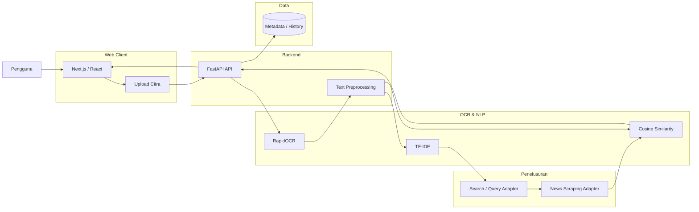
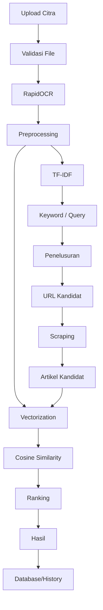

# DRAF HLD (HIGH-LEVEL DESIGN)

## Web Pencari Sumber Berita Berbasis Ekstraksi Teks Citra

### 1. Tujuan dan Ruang Lingkup HLD

HLD mendefinisikan arsitektur tingkat tinggi untuk sistem website yang menerima citra berita, mengekstraksi teks, menelusuri sumber berita, mengambil data artikel kandidat, dan melakukan perbandingan teks.

---

# 2. Gambaran Arsitektur Sistem

Arsitektur menggunakan pendekatan **web client – backend API – OCR/NLP service – retrieval/scraping – similarity – data store**.



---

# 3. Deskripsi Komponen

| Komponen | Peran | Tanggung Jawab | Teknologi Usulan |
| --- | --- | --- | --- |
| **Web Client** | Antarmuka | Upload citra dan menampilkan hasil | Next.js / React |
| **Upload Interface** | Input | Validasi dan mengirim citra | Browser API |
| **Backend API** | Orkestrasi | Mengatur pipeline | Python FastAPI |
| **OCR Service** | Ekstraksi teks | Mengubah citra menjadi teks | RapidOCR |
| **Preprocessing** | Normalisasi | Cleaning, case folding, tokenisasi sesuai kebutuhan | Python |
| **TF-IDF** | Pembobotan | Mengubah teks menjadi vektor berbobot | scikit-learn |
| **Search Adapter** | Penelusuran | Membentuk dan menjalankan query sumber berita | Modul retrieval |
| **Scraping Adapter** | Pengambilan data | Mengambil metadata dan teks artikel | requests + BeautifulSoup |
| **Similarity Service** | Perbandingan | Menghitung Cosine Similarity | scikit-learn |
| **Database** | Penyimpanan | Menyimpan metadata/riwayat bila diaktifkan | SQLite/PostgreSQL |

Pola scraping mengikuti tahapan jurnal rujukan: menentukan situs, mengeksplorasi struktur HTML, mengidentifikasi elemen penting, menjalankan scraping, dan menghasilkan data terstruktur. fileciteturn55file0

---

# 4. Keputusan Arsitektur

**Keputusan:** OCR dan NLP ditempatkan pada backend Python.

Alasan:
* RapidOCR dan ekosistem Python sesuai untuk pemrosesan citra dan teks.
* TF-IDF dan Cosine Similarity dapat dijalankan sebagai pipeline backend.
* Scraper dapat dipisahkan per sumber agar perubahan selector tidak memengaruhi komponen lain.

**[ASUMSI-01]** Mekanisme search provider final dapat diganti tanpa mengubah komponen similarity.

---

# 5. Aliran Data End-to-End



## Tahapan

### 1. Input

Pengguna mengunggah citra.

### 2. OCR

RapidOCR membaca teks pada citra dan menghasilkan teks digital.

### 3. Preprocessing

Teks dinormalisasi untuk mengurangi variasi yang tidak diperlukan.

### 4. TF-IDF

Sistem memberikan bobot pada kata dan memilih kata yang relevan sebagai dasar query.

### 5. Penelusuran

Query digunakan untuk memperoleh URL kandidat berita.

### 6. Scraping

Scraper mengunjungi halaman kandidat dan mengambil elemen yang diperlukan.

Jurnal rujukan menggunakan elemen seperti media, judul, subjudul, URL, isi, tanggal, editor, jurnalis, dan lokasi. Project ini mengambil subset yang diperlukan untuk penelusuran sumber. fileciteturn55file6

### 7. Similarity

Teks OCR dan artikel kandidat direpresentasikan dalam ruang vektor lalu dibandingkan menggunakan Cosine Similarity.

### 8. Ranking

Kandidat diurutkan berdasarkan nilai similarity.

### 9. Output

Frontend menampilkan judul, media, URL, tanggal jika tersedia, dan similarity score.

---

# 6. Fallback dan Error Handling

| Kondisi | Respons |
| --- | --- |
| File bukan citra | Tolak upload dan tampilkan pesan |
| OCR tidak menemukan teks | Minta pengguna mengunggah citra yang lebih jelas |
| Query kosong | Hentikan penelusuran dan tampilkan pesan |
| Search gagal | Tampilkan error dan opsi ulang |
| URL tidak dapat diakses | Lewati kandidat dan lanjutkan |
| Selector artikel tidak ditemukan | Tandai kandidat sebagai gagal scraping |
| Artikel tidak memiliki teks | Lewati perhitungan similarity |
| Semua kandidat gagal | Tampilkan bahwa sumber belum ditemukan |

---

# 7. Kontrak Antarkomponen Tingkat Tinggi

## 7.1 Client → Backend

```text
POST /api/search-source
Content-Type: multipart/form-data
```

Input:
```text
image: file
```

Output konseptual:
```json
{
  "ocr_text": "...",
  "keywords": ["..."],
  "results": [
    {
      "title": "...",
      "url": "...",
      "source": "...",
      "date": "...",
      "similarity": 0.87
    }
  ]
}
```

## 7.2 Backend → OCR

```text
Image
 ↓
RapidOCR
 ↓
OCRResult
```

## 7.3 Backend → Retrieval

```text
Keywords
 ↓
Search Adapter
 ↓
Candidate URLs
```

## 7.4 Backend → Scraper

```text
Candidate URL
 ↓
Scraping Adapter
 ↓
ArticleDocument
```

## 7.5 Backend → Similarity

```text
OCR Text + Article Text
 ↓
Vectorizer
 ↓
Cosine Similarity
```

---

# 8. Event Utama Sistem

| Event | Trigger | Proses | Output |
| --- | --- | --- | --- |
| **Image Uploaded** | Pengguna memilih file | Validasi | File valid |
| **OCR Completed** | OCR selesai | Preprocessing | Teks OCR |
| **Keywords Generated** | TF-IDF selesai | Query formation | Kata kunci |
| **Candidates Found** | Penelusuran selesai | Scraping | URL kandidat |
| **Article Scraped** | URL berhasil diproses | Parsing | ArticleDocument |
| **Similarity Completed** | Vectorization selesai | Cosine Similarity | Score |
| **Ranking Completed** | Semua score tersedia | Sorting | Daftar hasil |
| **Search Failed** | Error terjadi | Fallback | Error state |

---

# 9. Target Performance

Target awal tidak diambil dari jurnal rujukan karena jurnal tersebut tidak menguji pipeline RapidOCR + TF-IDF + Cosine Similarity project ini.

| Parameter | Target |
| --- | --- |
| OCR | Diukur melalui dataset berlabel |
| Retrieval | Diukur menggunakan precision/recall atau metrik retrieval yang ditetapkan |
| Similarity | Diukur menggunakan ground truth sumber |
| End-to-end latency | Diukur dari upload sampai hasil |
| Error handling | 100% skenario uji tidak menyebabkan crash |

---

# 10. Security & Privacy by Design

* File upload divalidasi berdasarkan tipe dan ukuran.
* File sementara dihapus setelah proses bila tidak diperlukan.
* URL eksternal ditampilkan sebagai sumber.
* Sistem tidak mengklaim kepemilikan artikel pihak ketiga.
* Isi artikel hanya diambil secukupnya untuk proses sistem dan mengikuti kebijakan akses sumber.
* Data riwayat hanya disimpan bila fitur tersebut diaktifkan.

---

# 11. Logging dan Data Store

```text
Search History
├── id
├── created_at
├── original_filename
├── ocr_text_hash
└── result_count
```

Hasil kandidat dapat disimpan:

```text
Search Result
├── search_id
├── title
├── source
├── url
├── published_at
└── similarity
```

---

# 12. Deployment Environment

## Development

```text
Developer PC
├── Next.js
├── Python FastAPI
├── RapidOCR
├── scikit-learn
├── BeautifulSoup
└── SQLite
```

## Staging

```text
Browser
  ↓
Frontend
  ↓
FastAPI
  ├── RapidOCR
  ├── Retrieval
  ├── Scraper
  └── Similarity
  ↓
Database
```

## Production / Demo

Frontend dan backend dapat ditempatkan pada layanan hosting yang mendukung kebutuhan masing-masing. Kemampuan infrastruktur harus diuji sebelum target latency ditetapkan sebagai hasil final.

---

# 13. Pemetaan Komponen terhadap Functional Requirement

| FR | Kebutuhan | Komponen |
| --- | --- | --- |
| FR-01 | Upload citra | Web Client |
| FR-02 | OCR | RapidOCR Service |
| FR-03 | Preprocessing | Text Processing |
| FR-04 | TF-IDF | NLP Service |
| FR-05 | Keyword | NLP Service |
| FR-06 | Penelusuran | Search Adapter |
| FR-07 | Scraping | Scraping Adapter |
| FR-08 | Similarity | Similarity Service |
| FR-09 | Ranking | Similarity/Ranking |
| FR-10 | Tampilan | Web Client |
| FR-11 | OCR preview | Web Client |
| FR-12 | Riwayat | Backend + Database |

---

# 14. Pemetaan Komponen terhadap Non-Functional Requirement

| NFR | Target | Komponen |
| --- | --- | --- |
| NFR-01 | Diukur | Backend + Retrieval |
| NFR-02 | Dataset berlabel | OCR + Similarity |
| NFR-03 | ≥95% task uji | Web Client |
| NFR-04 | 100% skenario uji | Backend + Error Handler |
| NFR-05 | Sesuai kebijakan | Backend + Storage |
| NFR-06 | Modular | Scraping Adapter |

---

# 15. Risiko Arsitektur

| Risiko | Dampak | Mitigasi |
| --- | --- | --- |
| OCR salah | Query tidak relevan | Preprocessing dan evaluasi OCR |
| Struktur HTML berubah | Scraping gagal | Adapter per sumber |
| Search menghasilkan banyak kandidat | Proses lambat | Batasi kandidat |
| Artikel serupa | Ranking ambigu | Gunakan metadata + similarity |
| Website memblokir request | Data tidak tersedia | Hormati akses dan gunakan fallback |
| Internet lambat | End-to-end latency tinggi | Timeout dan retry terbatas |
| Teks input pendek | Similarity kurang stabil | Minta input yang cukup informatif |

---

# 16. Ringkasan Arsitektur Akhir

```text
                    ┌───────────────────┐
                    │      USER         │
                    └─────────┬─────────┘
                              │
                              ▼
                    ┌───────────────────┐
                    │ Next.js / React   │
                    └─────────┬─────────┘
                              │
                              ▼
                    ┌───────────────────┐
                    │    FastAPI        │
                    └─────────┬─────────┘
                              │
                 ┌────────────┴────────────┐
                 ▼                         ▼
          ┌─────────────┐          ┌──────────────┐
          │  RapidOCR   │          │ Preprocessing│
          └──────┬──────┘          └──────┬───────┘
                 └────────────┬────────────┘
                              ▼
                       ┌─────────────┐
                       │   TF-IDF    │
                       └──────┬──────┘
                              ▼
                       ┌─────────────┐
                       │  Search     │
                       └──────┬──────┘
                              ▼
                       ┌─────────────┐
                       │   Scraper   │
                       └──────┬──────┘
                              ▼
                       ┌─────────────┐
                       │  Similarity │
                       └──────┬──────┘
                              ▼
                       ┌─────────────┐
                       │   Ranking   │
                       └──────┬──────┘
                              ▼
                       ┌─────────────┐
                       │    Result   │
                       └─────────────┘
```
