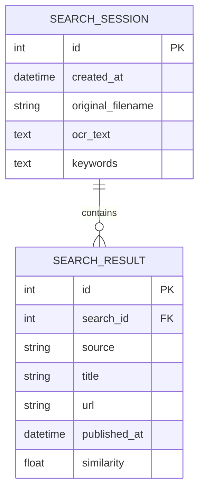

# ERD

## Entitas

## Penjelasan

### SEARCH_SESSION

Menyimpan informasi satu proses pencarian.

### SEARCH_RESULT

Menyimpan kandidat sumber yang dihasilkan dari satu proses pencarian.

**Catatan:** database bersifat opsional untuk prototype apabila riwayat pencarian tidak diperlukan.
