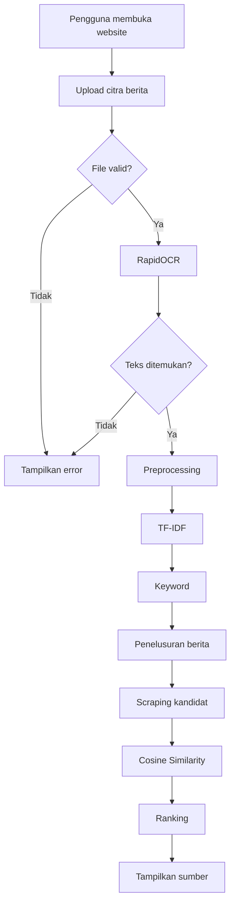

# USER FLOW

## Aktor

Aktor utama: **Pengguna**.

## Happy Path

1. Pengguna membuka website.
2. Pengguna mengunggah citra.
3. Sistem memvalidasi citra.
4. Sistem menjalankan RapidOCR.
5. Sistem membersihkan teks.
6. Sistem mengambil kata kunci.
7. Sistem menelusuri berita.
8. Sistem mengambil artikel kandidat.
9. Sistem menghitung similarity.
10. Sistem menampilkan ranking sumber.
